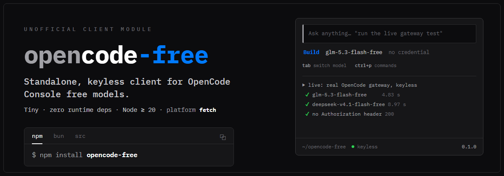

<div align="center">
  
</div>

# opencode-free

**Standalone, keyless client for OpenCode Console free models.**

```bash
npm install opencode-free        # or: copy ./src into your project
```

```ts
import { createOpenCodeFree } from "opencode-free";

const opencode = createOpenCodeFree({ client: "youragent", clientVersion: "1.0.0" });
const conversation = opencode.conversation("your-agent-session-id");

const answer = await conversation.chat({
  model: "glm-5.3-flash-free",
  system: "You are youragent, a coding assistant that can read files.",
  messages: [{ role: "user", content: "Summarise your role in one sentence." }],
  tools: [yourAgentRealReadTool],
});
console.log(answer.text);
// → real model output, no API key, no OpenCode Desktop, no other CLI runtime.
```

> **Unofficial community module.** Not built by, affiliated with, or endorsed
> by OpenCode. MIT-licensed, zero runtime dependencies, requires only a
> platform `fetch`.

---

## What this actually is (and what was verified)

This module is a faithful extraction of an integration that was **live-verified
against the real OpenCode gateway on 2026-10-22** (not mocks):

| Probe (real gateway, same day) | Result |
| --- | --- |
| User-Agent `opencode/latest/2.1.0/neo` + minted `ses_` session + `stream:true` + tools incl. `read` + own system prompt, **no credential** | **200 + real streamed answer** |
| Same shape, model `glm-5.3-flash-free` | **200 + real answer** |
| Same shape, model `deepseek-v4.1-flash-free` | **200 + real answer** |
| `read`-only tool variant (no other tools) | **200 + real answer** |
| Same shapes with version `1.7.0` in UA | **426 UpgradeRequired** ("OpenCode 1.18.0 or newer required") |
| No UA / OpenAI-SDK UA / malformed UA grammar | **403 FreeTierError** |
| No tools at all (same headers) | **403 FreeTierError** |
| UUID-shaped etc. session ids | **403 FreeTierError** |
| Dead/invalid credential attached | **401 "Upstream request failed: Invalid credential"** |

**What the module does with this contract:**

The bundled live test (`npm run test:live`, keyless) re-verifies this matrix
on demand against the real gateway; its most recent full pass was
2026-10-23. Concretely, the module:

- Identifies itself honestly in the gateway's documented UA grammar:
`opencode/latest/<version>/<client>` — the client slot is free-form and
carries **your agent's name** (default `opencode-free`).
- Mints session ids in OpenCode's own `ses_...` law
(`ses_<12hex><14base62>`, the `Identifier.descending()` reproduction) and
pins **one id per host conversation** across all four session headers the
official clients send (`x-opencode-session`, `x-opencode-session-id`,
`x-session-id`, `x-session-affinity`) — unlocking the gateway's prompt-cache
affinity per conversation.
- Sends `stream: true` plus **your** system prompt and **your** real tools
unchanged, and parses the SSE stream (text deltas, reasoning deltas,
tool-call argument fragments fully accumulated, `usage` when present).
- Fires **no credential ever**; the verified path is fully anonymous.
- Translates every gateway failure into a typed, actionable
`OpenCodeFreeError` (`free_tier_rejected`, `upgrade_required`,
`invalid_credential`, `rate_limited`, `gateway_error`, `invalid_request`),
retrying only what is safe to retry (429/5xx, pre-content, 5 linear-spaced
attempts by default).

**What it does NOT do (deliberately):**

- **No paid-model support.** Ids not ending in `-free` are rejected locally
  with a clear error. Paid OpenCode inference needs a Console API key
  (created at <https://opencode.ai/console>), and attaching credentials was
  beyond this module's verified scope — a dead key demonstrably *breaks* the
  otherwise-working anonymous request.
- **No forged tools, no embedded OpenCode prompt fingerprint.** For
  tool-less requests the gateway instead checks for OpenCode's own
  (copyrighted) system prompt — that content is NOT included here and the
  module refuses agent-less requests locally instead of trying to fake one.
- **No model catalog / no discovery calls.** Model ids come from you.
- **No telemetry, no tokens, no identity forgery.** The gate is a request
  *shape* check, and the module complies with the shape openly.

---

## API

```ts
import { createOpenCodeFree } from "opencode-free";

const opencode = createOpenCodeFree({
  client?: string;          // UA client slot, default "opencode-free"
  clientVersion?: string;   // your agent's semver; < 1.18.0 is clamped up
  fetchImpl?: typeof fetch; // injectable fetch (default: globalThis.fetch)
  baseUrl?: string;         // default https://opencode.ai/inference/openai/v1
  maxAttempts?: number;     // retryable-failure attempts, default 5
  retryBackoffMs?: number;  // linear backoff base, default 1200
});

const conversation = opencode.conversation(idOrUndefined);
// conversation.sessionId — the stable minted ses_... id (for debugging)

for await (const event of conversation.stream({
  model: "glm-5.3-flash-free",
  system: "…your agent's own system prompt…",
  messages: [...],          // OpenAI chat-completions shaped, passes through
  tools: [yourRealReadTool],
  timeoutMs?: number,
  signal?: AbortSignal,
})) {
  switch (event.type) {
    case "text":        /* event.delta */ break;
    case "reasoning":   /* event.delta */ break;
    case "tool_call":   /* event.call.arguments — complete */ break;
    case "done":        /* event.finishReason, event.usage? */ break;
  }
}

// or without a loop:
const result = await conversation.chat({ ... });
// result: { text, reasoning, toolCalls, finishReason, usage? }
```

Error surfaces as `OpenCodeFreeError` with `.code`, `.status`, `.detail`.

---

## Model configuration

This module covers **free models only** — ids ending in `-free`.
`glm-5.3-flash-free` and `deepseek-v4.1-flash-free` were each verified
individually with real responses. Other `-free` ids published by the OpenCode
Console catalog list share the verified request shape, but they have **not**
been probed one-by-one — treat them as "same mechanism, individually
unverified". There is no catalog fetch here; keep your own list of ids your
host supports (do not hardcode trust in the backend that every `-free` id is
permanently free).

## Configuration reference

| Option | Env override | Meaning |
| --- | --- | --- |
| `client` / `clientVersion` | — | UA client slot (be honest) and your semver |
| — | `OPENCODE_UA_VERSION` | Raise the declared version if the gateway raises its floor. Values below `1.18.0` are clamped (they only buy a guaranteed 426). |
| `maxAttempts` / `retryBackoffMs` | — | Retry budget for 429/5xx (5 × 1.2s-spaced by default) |

## Integration guide for host agents / CLIs

1. **Install** `npm install opencode-free` **or copy `./src/*.ts` (no
   transitive deps) into your tree.**
2. **Pick the mapping point**: wherever your agent dispatches a model to a
   provider (`streamFn(model, context, options)`-like). Wire the free model
   branch there:

```ts
if (isFreeOpenCodeModelId(model.id) && model.provider === "opencode") {
  const conversation = opencode.conversation(sessionManager.currentId);
  return conversation.stream({
    model: model.id,
    system: context.systemPrompt,          // YOUR prompt — not OpenCode's
    messages: convertToLlm(context.messages),
    tools: agent.openAiTools(),            // MUST contain your real `read`
    signal: options.signal,
  });
}
```

— then adapt — your event loop consumes `StreamEvent`s the same way it
consumes your other providers' deltas.

3. **`read` tool requirement:** include your agent's real file-reading tool
   (its real schema and description). The gate rejects tool-less requests,
   and a fake placeholder tool defeats the point (the model may actually
   call it). Any real coding agent already has this tool; if none exists,
   this module is not applicable.
4. **Errors:** catch `OpenCodeFreeError`; its `code` is stable for display,
   and `upgrade_required` messages name the env override that unblocks you
   without a module release.
5. **Session identity:** pass your conversation/session id as the
   `conversation()` key — one stable gateway session per conversation,
   prompt-cache affinity preserved. Passing nothing is allowed (id minted
   per call) but skips the affinity benefit.

### Honest compatibility statement

This is **not** a universal drop-in for every agent architecture. The
methods above are the entire contract surface; agents whose message shapes
differ from OpenAI chat-completions will need their own small adapter layer
for `messages`/`tools`. The module intentionally does not ship in-host
plumbing like tool executors, replays, histories, or prompt templating.

## Limitations and service restrictions (read before relying on this)

- **De-facto, undocumented gate.** The request shape is what the gateway
  enforces today; OpenCode does not publicly specify it (their issue tracker
  shows third-party clients asking for documented guarantees). The team can
  change the shape or strictness at any time. Failures stay typed and
  actionable, but service availability is OpenCode's, not this module's.
- **Free tier is not contractual.** Model availability, ids, rate limits and
  per-IP state have all been observed to vary; 429s occur under rapid
  request sequences. One community incident (October 2026) showed official
  users temporarily blocked entirely — no client shape survives such windows.
- **Request-shape gates, not identity:** the module sends no credential and
  will never try to bypass a *credential* check. If OpenCode converts the
  free tier into an authenticated product, this module breaks — by design
  it will not fake credentials.
- **Streaming-only endpoint contract:** the client always sends
  `stream: true` (part of the verified shape). Non-streaming responses are
  not supported by the free tier's verified shape.
- **Reasoning/usage are best-effort:** `reasoning` deltas and `usage` appear
  per model/gateway and are surfaced only when present.
- **English-enforced client identity:** the UA announces the module or your
  agent's name — attribution the gateway already had to see; that is exactly
  what its grammar slot is for.

## Tests

```bash
npm install
npm test          # 46 deterministic, network-free tests (node:test + tsx)
npm run typecheck # strict tsc pass
npm run build     # dist/ + declarations

# Real-gateway integration (needs NO key; makes network calls):
npm run test:live
```

`test/live.test.ts` is skipped unless `OPENCODE_FREE_LIVE=1` is set, so CI
never depends on the third-party network. The live file re-verifies the full
matrix on both verified models and fails loudly on any deviation.

## Runnable example

[`examples/mini-agent.ts`](examples/mini-agent.ts) is the smallest complete
agent loop on this module: user question → free model streams (or calls the
real `read` tool, which the example executes with `fs.readFile`) → tool
result back to the model → final answer. No key, no OpenCode Desktop:

```bash
node --import tsx examples/mini-agent.ts "Read src/errors.ts and count its exported functions"
```

To adapt it into your agent, replace the example's `readTool`/`executeRead`
with your real tool registry and the hard-coded system prompt with yours.

## License

MIT — see [LICENSE](LICENSE). Copyright (c) 2026 Raushan.
